

<picture><source media="(prefers-color-scheme: dark)" srcset="assets/hero-dark.svg"></picture>

<picture><source media="(prefers-color-scheme: dark)" srcset="assets/social-l-dark.svg"></picture><a href="https://t.me/"><picture><source media="(prefers-color-scheme: dark)" srcset="assets/social-1-dark.svg"></picture></a><a href="https://discord.com/"><picture><source media="(prefers-color-scheme: dark)" srcset="assets/social-2-dark.svg"></picture></a><a href="https://x.com/"><picture><source media="(prefers-color-scheme: dark)" srcset="assets/social-3-dark.svg"></picture></a><picture><source media="(prefers-color-scheme: dark)" srcset="assets/social-r-dark.svg"></picture>

<picture><source media="(prefers-color-scheme: dark)" srcset="assets/about-dark.svg"></picture>

<picture><source media="(prefers-color-scheme: dark)" srcset="assets/stack-dark.svg"></picture>

<a href="https://github.com/deepsytxt/MyBioSite"><picture><source media="(prefers-color-scheme: dark)" srcset="assets/project-mybiosite-dark.svg"></picture></a>&nbsp;<a href="https://github.com/deepsytxt/deepsytxt"><picture><source media="(prefers-color-scheme: dark)" srcset="assets/project-deepsytxt-dark.svg"></picture></a>

<a href="https://github.com/deepsytxt/TgBotDeepsy"><picture><source media="(prefers-color-scheme: dark)" srcset="assets/project-tgbotdeepsy-dark.svg"></picture></a>&nbsp;<a href="https://github.com/deepsytxt/Fsociety-visual"><picture><source media="(prefers-color-scheme: dark)" srcset="assets/project-fsociety-visual-dark.svg"></picture></a>

<picture><source media="(prefers-color-scheme: dark)" srcset="assets/stats-dark.svg"></picture>

<picture><source media="(prefers-color-scheme: dark)" srcset="assets/streak-dark.svg"></picture>

<picture><source media="(prefers-color-scheme: dark)" srcset="assets/wave-dark.svg"></picture>

<a href="https://deepsybio.netlify.app/"><picture><source media="(prefers-color-scheme: dark)" srcset="assets/button-1-dark.svg"></picture></a>&nbsp;&nbsp;<a href="https://github.com/deepsytxt?tab=repositories"><picture><source media="(prefers-color-scheme: dark)" srcset="assets/button-2-dark.svg"></picture></a>

<a href="https://metawka.github.io/expressive-profile/?from=deepsytxt"><picture><source media="(prefers-color-scheme: dark)" srcset="assets/credit-dark.svg"></picture></a>

